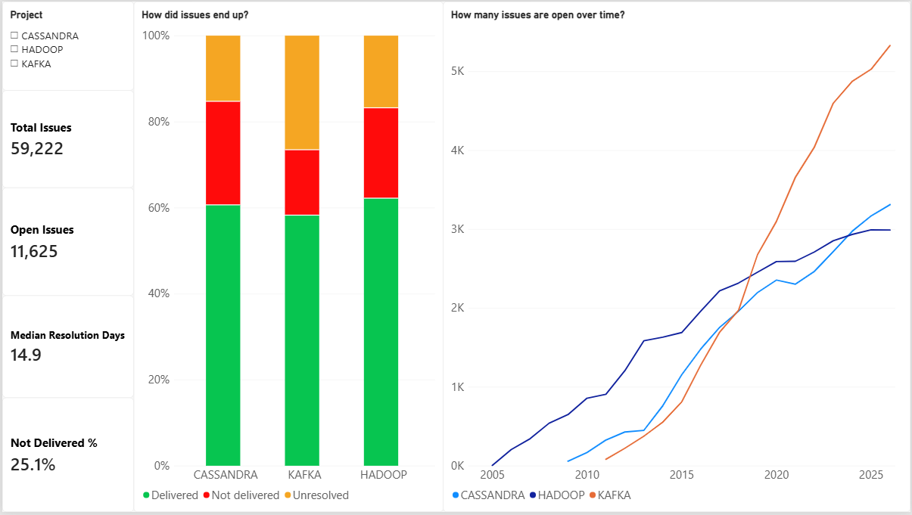
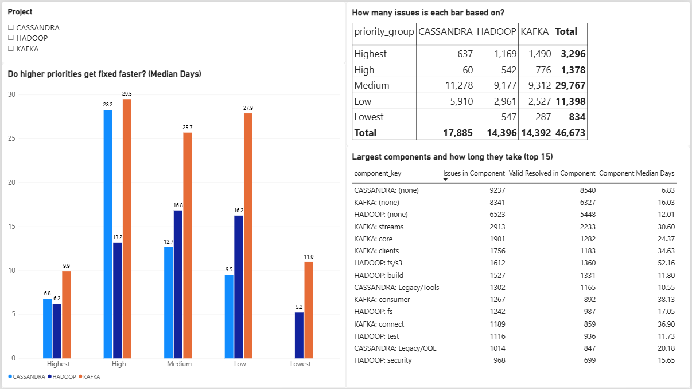
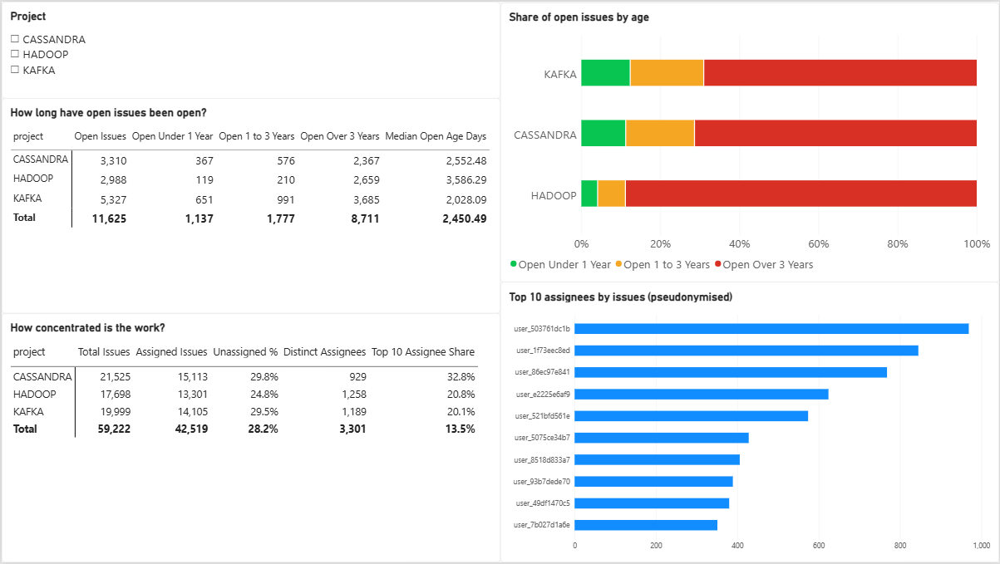
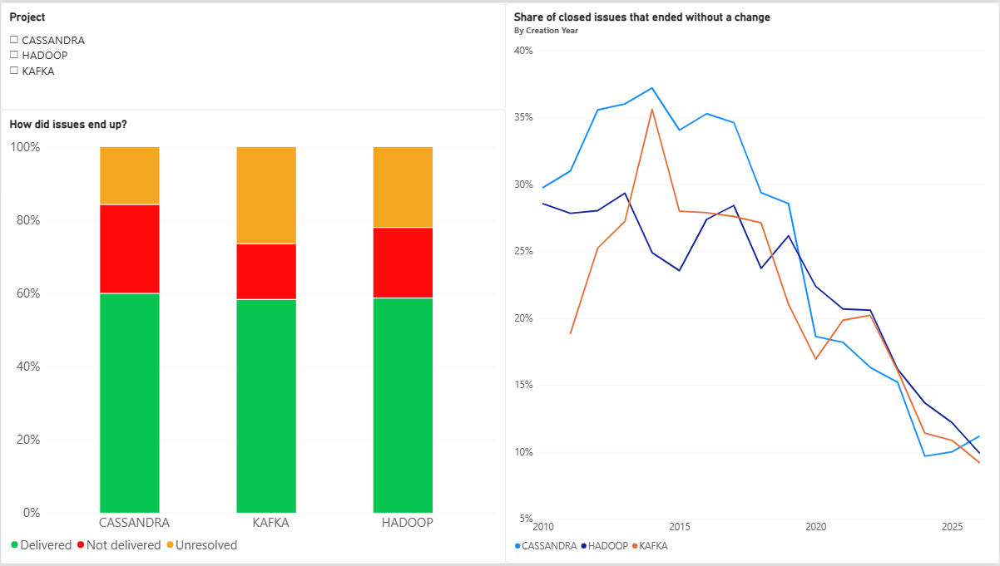

# Jira Ticket Health Dashboard

How healthy are the issue trackers of three large Apache projects? This project pulls 59,222 public Jira issues from **Apache Kafka, Cassandra and Hadoop**, cleans and models them, and answers seven questions about backlog, speed, priorities, components, ageing, outcomes and ownership in a five-page Power BI dashboard.



## Questions and findings

All figures come from the snapshot of 15 October 2026: 59,222 issues, of which 47,597 are resolved and 11,625 still open.

| # | Question | Finding |
|---|---|---|
| 1 | How has the open backlog developed? | It has grown steadily in all three projects. Today Kafka has 5,327 open issues, Cassandra 3,310 and Hadoop 2,988. |
| 2 | How long does a typical issue take to resolve? | The median is 14.9 days overall: Cassandra 11.3, Hadoop 14.3, Kafka 22.2. |
| 3 | Do higher priorities get fixed faster? | Only the top tier does. Highest-priority issues take 6 to 10 days in every project. Below that, priority barely predicts speed: in Kafka, High, Medium and Low all take about 26 to 30 days. |
| 4 | Which components are largest, and which are slow? | Hadoop `fs/s3` is the slowest large component at 52.2 days. Kafka's consumer, connect, clients and streams components take 31 to 38 days. Build, test and packaging components are fast (about 7 to 12 days). |
| 5 | How old are the open issues? | 75% of all open issues (8,711 of 11,625) have been open for more than three years. For Hadoop it is 89%, and the median open issue is about 9.8 years old. |
| 6 | How do issues end, and does that change over time? | 25.1% of closed issues ended without a change (Won't Fix, Duplicate, and similar): Cassandra 28.4%, Hadoop 25.3%, Kafka 20.7%. The share peaked around 2013 to 2017 and is about 10% for recent issues, partly because recent issues have not yet been through cleanup closures. |
| 7 | How concentrated is the work? | Ownership is broad: 3,301 distinct assignees, and 28.2% of issues have none. The top ten assignees hold 32.8% of Cassandra's assigned issues, against about 20% for Hadoop and Kafka. |

## Dashboard pages

| Page | Content |
|---|---|
| Overview | KPI cards, outcome mix per project, open backlog over time |
| Speed | Resolution time by priority, largest components and their median time |
| Backlog and people | Age of open issues, concentration of assignees |
| Outcomes | Share of closed issues that ended without a change, by creation year |
| Data checks | Totals and a backlog reconciliation that tie back to the cards (59,222 − 47,597 = 11,625) |

The project slicer on the four analysis pages is synchronised, so one selection applies to all of them.

### Speed: do higher priorities get fixed faster, and which components are slow?

### Backlog and people: how old are the open issues, and how concentrated is the work?

### Outcomes: how do issues end, and does that change over time?


## Data

- **Source:** the public Apache Jira REST API (v2), projects KAFKA, CASSANDRA and HADOOP.
- **Fields:** key, type, priority, status, resolution, created and resolved dates, components, assignee.
- **Politeness:** one request per second, 100 issues per request, automatic retry when the server asks to slow down.
- **Privacy:** assignee usernames are replaced by a salted SHA-256 hash (`user_` plus ten characters). The salt is private and not in this repository. Issue summaries are not carried into the model.

## Method

**Pipeline:** `jira_pull.py` downloads one CSV per project, `clean_data.py` produces one clean row per issue plus an issue-to-component table, `build_model_tables.py` writes the star-schema tables, and Power BI loads them.

**Cleaning decisions**

- Blanks become explicit labels (`Unassigned`, `(none)`, `(unresolved)`), so those issues stay visible in charts.
- About twenty resolution values are grouped into **Delivered** (Fixed, Implemented, Done, ...), **Not delivered** (Won't Fix, Duplicate, Invalid, ...) and **Unresolved**.
- The projects use different priority names, so they are mapped onto one five-step scale: Blocker and Urgent become Highest; Critical and High become High; Major and Normal become Medium; Minor and Low become Low; Trivial becomes Lowest. This mapping is an assumption, so priorities are only compared within a project.
- **Fake durations are excluded from time measures.** 924 of the 47,597 resolved issues are flagged: 102 were resolved within 60 seconds of creation (import artefacts), and 822 were closed in mass-cleanup sweeps (days on which a project closed at least 40 issues, fewer than half of them delivered). Sweep days that were genuine release work are kept. This moves the medians by less than a day, but it stops cleanup days from distorting the speed questions.

**Data model (star schema)**

- `fact_issues` with dimensions `dim_project`, `dim_priority` and `dim_date`.
- `dim_component` and a bridge table, because one issue can have several components (65,137 issue-component pairs for 59,222 issues).
- `dim_date` is a role-playing dimension: the active relationship uses the created date, an inactive one uses the resolved date and is activated with `USERELATIONSHIP`.

**DAX worth looking at**

- `Open Backlog`: issues created so far minus issues resolved so far, per month. Unresolved issues have no resolved date and fall into the blank row of the date table, so the resolved count filters on `is_resolved`.
- Component measures use `CROSSFILTER(..., BOTH)` so that the bridge table filters the fact table inside one measure only.
- Median measures return blank when a group has fewer than 30 valid issues, so small groups do not produce misleading bars.

## Limitations

- **Median resolution time covers resolved issues only.** Issues still open are not in it, so it understates how long the hardest issues take.
- **Age is not inactivity.** "Open for three years" says nothing about whether someone commented last week.
- **The shared priority scale is an assumption**, and the Cassandra "High" tier has only 60 valid issues.
- **Components are missing on 37 to 43% of issues**, so component findings describe the tagged majority.
- **"Assignee" is the current owner**, not necessarily the person who resolved the issue.
- **Recent years look better** in the outcome trend partly because newer issues have not been through cleanup closures yet.
- The snapshot is dated 15 October 2026; numbers change as the projects move on.

## Reproduce it

Requires Python 3.14 (any recent 3.x should work) and Power BI Desktop (Windows). Run everything from the project root.

```
pip install -r requirements.txt
python scripts/jira_pull.py KAFKA CASSANDRA HADOOP
python scripts/clean_data.py
python scripts/build_model_tables.py
```

Before the first run, open `scripts/jira_pull.py` and set your own contact email in `HEADERS` and a private random string as `SALT`. Do not commit either. Add `--limit 200` to the pull for a quick test.

The Power BI file already contains the data, so it opens without any of the above. To refresh it from your own run, point the queries at `data/model/` under Transform data > Data source settings.

## Repository layout

```
scripts/      pull, clean and model scripts
dashboard/    Jira_Ticket_Health.pbix and a PDF export
docs/         dashboard screenshots
data/         created by the scripts (not committed)
```

## Author

Satyam Satyarthi, M.Sc. Business Intelligence & Data Science (ISM, Munich).
